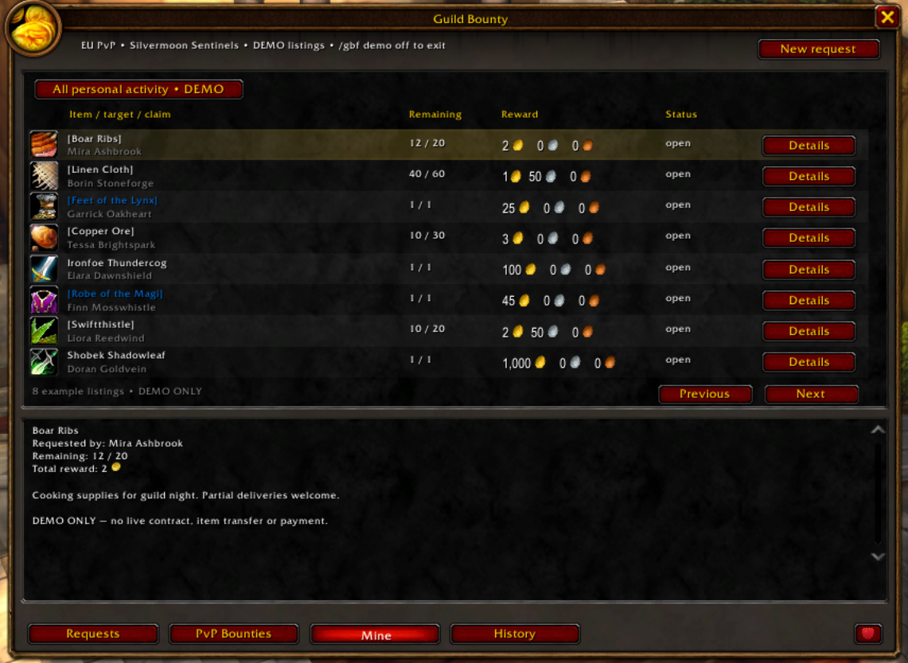
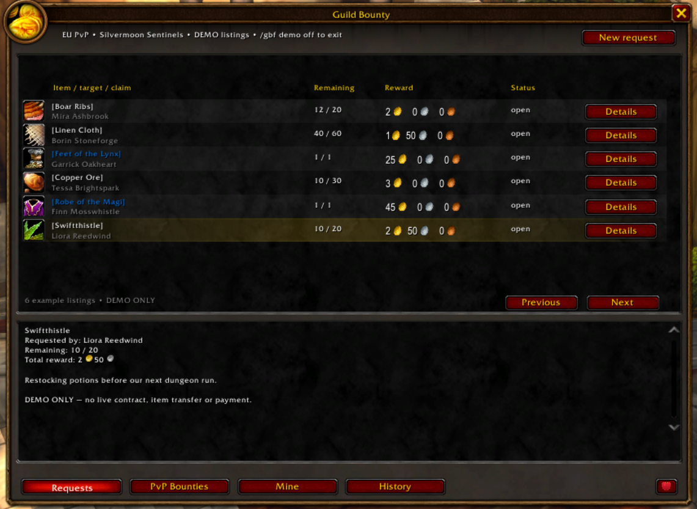
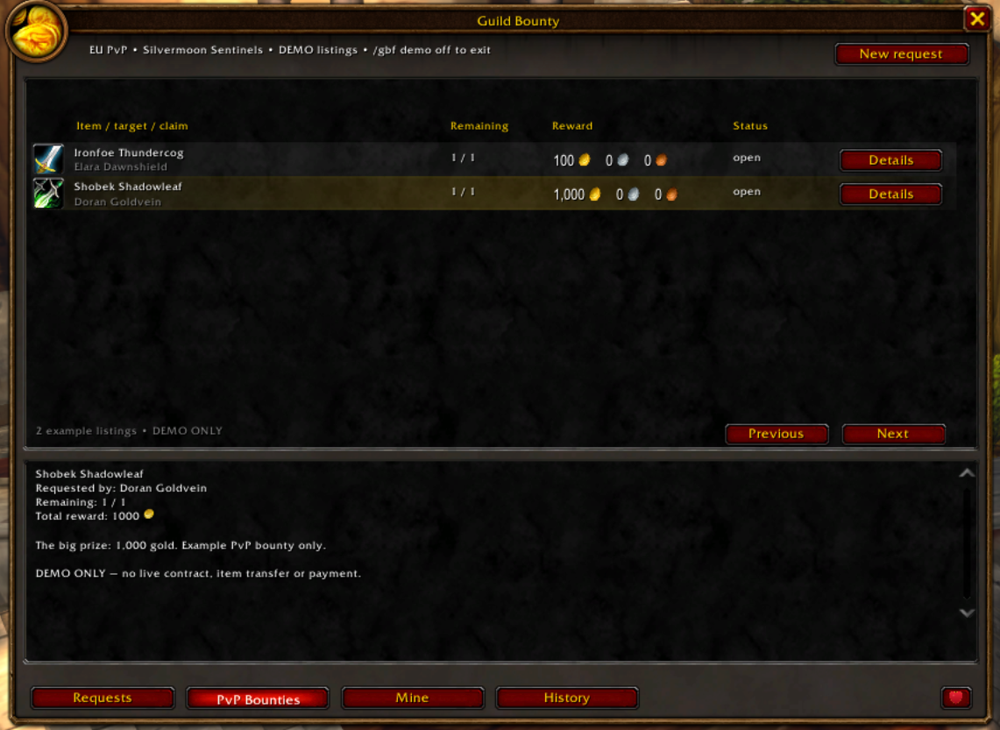

# Guild Bounty Forever

**Your guild wants it. You just looted it. Get paid for connecting the dots.**

Ever vendored a green and wondered whether a guildmate would have loved it? Ever needed twenty Boar Ribs and wished the whole guild could help without another wall of chat?

Guild Bounty Forever turns those moments into a shared bounty board: ask for an exact item, describe your dream upgrade with configurable rules, or put a price on an enemy player's head.

Built for **World of Warcraft Forever 1.60.1 — interface 16001**. Public release **1.0.0**.

*Actual in-game capture using isolated example listings. No live bounties are created.*

## From unwanted loot to wanted loot

- **Exact item requests:** drop in an item, shift-click its link, or enter its ID. Set quantity, total reward and a note.
- **Your next upgrade, described:** choose item type, subtype and equipment slot from dropdowns. Set minimum/maximum required character level. Add multiple stat ranges such as Strength and Stamina; Apply locks each row with a confirmation sound. No sample item is required.
- **Loot that gets your attention:** matching acquisitions show a compact prompt with item artwork, bounty and reward. Check items already in your bags with `/gbf matches`.
- **Delivery without arranging a meeting:** accept a quantity and COD amount, visit a mailbox, and click Prepare delivery. The addon selects matching items, splits stacks and fills the native mail draft. Review it and manually click Send.
- **Both sides stay informed:** confirmed sends, matching deliveries, COD acceptance and receipts update claims. Supported, correlated payment collections are recorded too. Unverifiable events remain available for manual review.
- **PvP with a purpose:** list an opposing player by full Forever name or capture your target. Prompts include available class/faction artwork and rank information. PvP rewards use manual settlement.
- **A board that remembers:** Requests, PvP Bounties, Mine and History keep your guild's work organized. Guild synchronization works without a hosted service.
- **Learn by doing:** the first-launch guided tour opens the addon, points at real buttons and walks you through isolated example listings, stat rules, claims and mail. Replay it with `/gbf help`.
- **A little love, a little revenge:** the bottom-right heart offers a thank-you or one of 100 randomly chosen Azerothian roasts. No real-money support is requested.

## Try these bounties

| You want… | Create… | What happens next |
|---|---|---|
| Boar Ribs for cooking | Exact Item, quantity 20, your total reward | Guildmates matching the item can arrange a partial or full delivery. |
| A rare BoE upgrade | Exact Item: Feet of the Lynx or Robe of the Magi | A matching acquisition prompts a guildmate to arrange delivery. |
| A useful leveling weapon | Rule Request: Weapon → Two-Handed Maces → Two-Hand, required level 20–30 | Compatible drops become candidates without specifying an item ID. |
| Strength **and** Stamina | Add and Apply separate minimum-stat rows | Every applied criterion must match. Edit/remove rows independently. |
| Materials without chasing sellers | Exact Item plus a note explaining your order | A supplier accepts, visits mail and prepares a COD draft. |
| Revenge on a recurring enemy | PvP Target with the full two-part name | Available public combat evidence can support a claim; payment is agreed manually. |
| To see your own progress | Mine | Review your listings, claims and completed activity in one place. |
| To learn without risking gold | `/gbf help` | Walk through demonstration data without sending mail or moving inventory. |

## Mail, with you in control

**Find → accept → visit a mailbox → Prepare delivery → review → manually Send → recipient accepts COD.**

**COD receipt and payment are recorded automatically after confirmed collection.** The board images are actual in-game screenshots using display-only example names, materials, rare BoE items and PvP targets. Current confirmed COD collection updates the claim automatically while both players have the addon enabled. Gold is not escrowed, and the addon cannot bypass server mail restrictions. Unrelated mail or simply opening the inbox does not mark a bounty paid.

Guild communication requires guild membership. Without a guild, you can create local requests, run the tour and use the local COD test. All participating guildmates should install the same release.

## Install and play

1. Download the release ZIP and extract **GuildBountyForever** into `_forever_/Interface/AddOns/`.
2. Enable the addon and restart the client if this is a first installation; otherwise `/reload`.
3. Complete the guided introduction, then open the board with `/gbf`.

| Command | Action |
|---|---|
| `/gbf` | Open or close the board |
| `/gbf help` | Replay the interactive introduction |
| `/gbf matches` | Check inventory for matching requests |
| `/gbf testcod` | Preview delivery or run a labelled unguilded self-mail test |
| `/gbf status` | Show version, context and diagnostic status |

Self-mail still depends on your server permitting it. A rejected send stays unsent. See the [full user guide](docs/USER_GUIDE.md) for claims, partial deliveries, identity and synchronization details.

## Development and verification

The project includes runtime Lua, original heart artwork, regression tests and packaging tools. Run `python3 tools/validate.py` with LuaJIT and Lua 5.4 installed. Build the installable archive with `python3 tools/package.py`.

Terminal regression checks cover identity, migration, synchronization, loot matching, forms, tutorial isolation, mail tracking and the heart flow. Native rendering and two-client server behavior require in-game verification. This package targets Forever; compatibility with Retail, Classic or other client interfaces is not claimed.

Found a problem? Open an issue with the addon version, steps to reproduce and `/gbf status`. Do not upload account folders or SavedVariables containing other players' data.

Demo PvP targets include **Ironfoe Thundercog** and **Shobek Shadowleaf**, with an example **1,000g** reward on Shobek. These images do not create or advertise a live contract.

Made by **Ironfoe Thundercog**. No real-money donations. Enjoy WoW Forever :)
